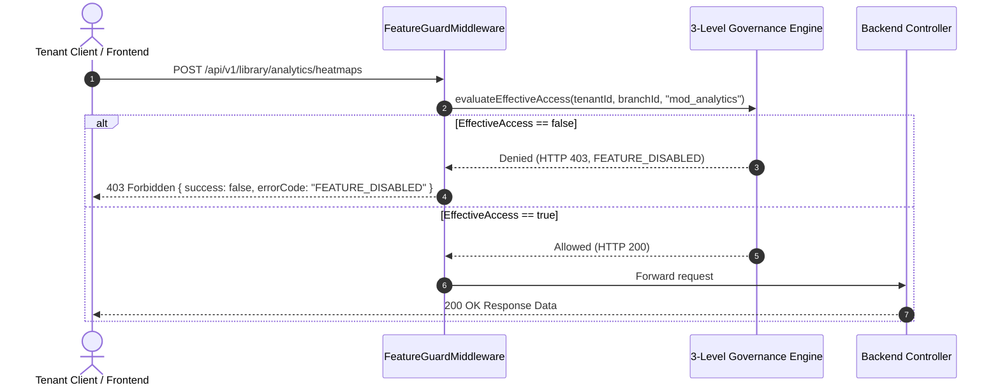

# Architecture: Feature & Module Control Governance

## Mathematical Resolution Formula
The effective access status for any given library tenant, branch, and module is resolved as follows:

$$
\text{EffectiveAccess} = \text{PlatformDefault} \land (\text{PlanEntitlement} \lor \text{TenantOverride})
$$

### Rule Definitions:
1. If $\text{PlatformDefault} = \text{false}$, $\text{EffectiveAccess} = \text{false}$ (Platform killswitch).
2. If $\text{PlatformDefault} = \text{true}$:
   - If $\text{TenantOverride} = \text{Force\_Enabled}$, $\text{EffectiveAccess} = \text{true}$ (regardless of subscription plan).
   - If $\text{TenantOverride} = \text{Force\_Disabled}$, $\text{EffectiveAccess} = \text{false}$ (regardless of subscription plan).
   - If $\text{TenantOverride} = \text{null}$, $\text{EffectiveAccess} = \text{PlanEntitlement}(\text{Tier})$.

## API Denial Guard Flow

## Architectural Boundaries
- Strict file length limits: `< 300 lines` per file.
- Direct modular imports: Zero barrel files.
- Non-blocking confirmation: Zero `window.confirm` or `window.alert`.
